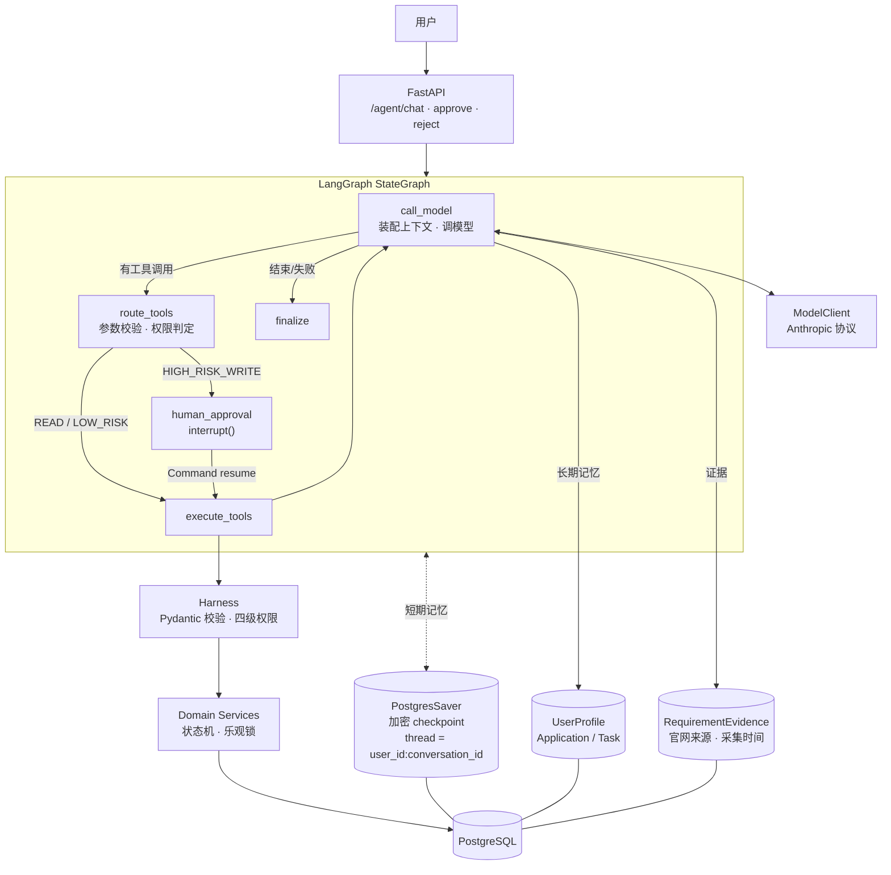

# ApplyPilot

ApplyPilot 是一个面向中文用户的留学申请 AI Agent，也是我的全栈开发项目。

用户可以通过对话查询院校项目、比较申请要求、分析个人背景，并把选校结果转化为申请计划和材料任务。项目重点不只是接入大模型，而是实现一套可执行、可确认、可追踪的 Agent 工作流。

## 主要功能

- AI 对话查询院校项目和申请要求
- 个人档案管理，包括 GPA、语言成绩、经历和申请方向
- 项目搜索、筛选及最多三个项目的对比
- 根据档案生成冲刺、匹配和稳妥分类
- 查看申请要求对应的官网来源和验证状态
- 使用看板管理申请进度、材料任务和截止日期
- 修改关键数据或高风险申请状态前要求用户确认，后端重启后仍可恢复确认
- 保存对话与运行记录，刷新后可以继续查看
- 关键申请要求必须附带真实证据引用，程序会做确定性核对

目前项目库包含新加坡、中国香港和英国的 7 所学校、11 个授课型硕士项目。

## Agent 设计

Agent 使用兼容 Anthropic Messages 协议的模型接口，编排层基于 **LangGraph StateGraph**。模型负责理解用户目标和选择工具，实际的数据读取与写入由后端工具层完成。

### 为什么用 LangGraph

早期版本是一个进程内的 `while` 循环，等待用户确认的运行状态只存在内存里。这带来两个真实问题：后端重启或多 Worker 部署时，待确认的高风险操作会直接丢失；对话历史也无法跨进程恢复。

LangGraph 提供了现成的**中断（interrupt）与持久化检查点（PostgresSaver）**，把"暂停等人确认"变成图的一等公民，不需要自己实现状态机和恢复逻辑。



### 工具调用闭环

Agent 可以调用档案、项目、申请和官网研究等工具。一轮回复可以包含多个工具调用，执行结果会以结构化数据返回模型，模型再决定继续调用工具还是生成最终回答。

API 和 Agent 工具共用同一套领域服务，因此网页操作与 Agent 操作遵守相同的参数校验、权限和事务规则，模型不能直接修改数据库。

### Human-in-the-loop

工具会根据当前用户、操作类型和参数判断风险。读取档案或搜索项目可以直接执行；修改 GPA、IELTS，以及提交、撤回、录取或拒绝申请等操作需要用户确认。

如果一批工具调用中存在需要确认的操作，整批调用会暂停。用户确认后继续原来的运行，而不是重新让模型生成工具参数，避免重复执行或只完成一部分操作。

暂停通过 LangGraph 的 `interrupt()` 实现，运行状态加密写入 PostgreSQL checkpoint；确认时用 `Command(resume=...)` 从中断点继续。**后端重启后待确认的操作仍然可以批准**。thread 标识为 `user_id:conversation_id`，天然隔离不同用户的会话。

### 上下文与记忆

每轮模型调用的上下文是现场装配的，而不是把整库倒给模型：

```text
SYSTEM  +  [USER_PROFILE]  +  [CURRENT_APPLICATION_CONTEXT]
        +  [CONVERSATION_SUMMARY]（历史过长时才有）
        +  [AVAILABLE_EVIDENCE]（本轮读到的证据）
        +  最近若干轮原始消息
```

- **短期记忆**：LangGraph State + PostgresSaver 检查点，按 thread 保存完整历史；模型输入只取最近若干轮，历史超过阈值时压缩一次摘要（不是每轮都摘要）。裁剪保证 `tool_use` 与 `tool_result` 成对，不会产出非法历史。
- **长期记忆**：直接复用 `UserProfile` / `Application` / `ApplicationTask` 等业务表，没有另建 memory 表。用户明确提供的稳定事实（GPA、语言成绩、目标地区）通过既有工具写入；"这次只看新加坡"这类临时条件只留在当前会话，不会写进档案。
- 摘要与数据库冲突时**以数据库为准**，系统提示中对此有明确约束。

### 安全边界

- 用户身份来自后端登录上下文，不接受模型传入的用户 ID 或管理员权限
- 工具名称和参数在执行前进行校验
- Agent 设置步骤数和工具调用次数上限，防止无限循环
- 前端只渲染白名单中的结构化工具结果，不展示原始工具参数
- 工作区在每轮对话后重新读取业务 API，以数据库结果为准
- 运行记录不保存思维链、系统提示词和原始工具输出

### 证据与事实约束

院校要求会保存官网 URL、采集时间、原文片段和验证状态。模型从官网提取字段时，需要同时返回对应原文；程序会检查原文是否真实存在于抓取页面中，无法匹配的数据不会进入可信结果。

如果两个官方页面给出不同要求，系统会保留冲突证据并标记为待核实，而不是自动选择其中一个值。查不到可靠信息时，Agent 会明确说明信息缺失。

**Evidence Verifier** 是一段普通 Python 代码，不是第二个模型、也不是 Reviewer Agent。工具返回的每条要求都带 `evidence_id`；模型陈述关键事实时必须附上机器可读的引用，程序对其做四项确定性核对：

| 检查 | 内容 |
| --- | --- |
| Citation existence | `evidence_id` 必须来自本轮真正读过的工具结果 |
| URL consistency | 引用的来源网址与该证据一致 |
| Value consistency | 数值按数值比较，`7.0` 不能被写成 `6.5` |
| Cycle consistency | 2026/27 的证据不能无说明地用于其他申请季 |

核对失败最多触发一次受控重写；仍失败则返回保守回答，说明哪项无法确认，不给出具体数值。没有已发布证据的要求（例如 `conflict_pending`）不会进入可引用清单，因此无法被当作有出处的事实。

### 安全测试

针对本项目业务的 Prompt Injection 测试共 23 项。核心立场是：**防护由代码保证，不依赖模型听话**——测试里模型完全按注入指令行事，然后断言系统仍然安全。

覆盖：直接注入要求跳过权限、要求跳过人工确认、身份伪造（参数携带他人 `user_id`）、间接注入（工具结果内含攻击文本）、system prompt 提取、要求编造要求数值。

### 会话与可观测性

每次提问都会生成独立的 Agent 运行记录，同一会话可以包含多次运行。数据库保存用户可见的问题、回答、运行状态、工具调用次数和安全的执行事件，用于恢复对话及排查失败原因。

## 技术栈

| 模块 | 技术 |
| --- | --- |
| 前端 | React、TypeScript、Vite、Tailwind CSS、TanStack Router/Query |
| 后端 | FastAPI、SQLModel、Alembic |
| 数据库 | PostgreSQL |
| Agent | LangGraph（StateGraph、interrupt/resume、PostgresSaver）、Anthropic Python SDK、Tool Calling |
| 部署 | Docker Compose |
| 测试 | pytest、Playwright |

## 本地运行

需要提前安装 Docker Desktop、Node.js 和 npm。

### 1. 配置环境变量

```powershell
Copy-Item .env.example .env
```

修改 `.env` 中的必要配置：

```dotenv
SECRET_KEY=<随机字符串>
POSTGRES_PASSWORD=<数据库密码>
FIRST_SUPERUSER_PASSWORD=<管理员密码>
```

使用 AI 对话还需要配置兼容 Anthropic Messages 协议的服务：

```dotenv
AGENT_BASE_URL=https://api.deepseek.com/anthropic
AGENT_API_KEY=<API Key>
AGENT_MODEL=deepseek-v4-flash
```

启用 LangGraph 引擎（默认仍是旧循环）需要再配置：

```dotenv
AGENT_ENGINE=graph
CHECKPOINT_ENCRYPTION_KEY=<16、24 或 32 字节>
```

checkpoint 会存下完整对话与工具结果，因此密钥与 `SECRET_KEY` 分开管理。`local` 之外的环境缺少该密钥会**直接启动失败**，不会退回明文存储。checkpoint 内部表由官方 `PostgresSaver.setup()` 建立，作为受控部署步骤在 `scripts/prestart.sh` 中执行。

### 2. 启动数据库与后端

```powershell
docker compose up -d db mailcatcher backend
```

### 3. 导入项目数据

```powershell
docker compose exec backend python -m app.seed_gold_requirements
```

### 4. 启动前端

```powershell
npm install
npm run dev
```

启动后可以访问：

- 前端：<http://localhost:5173>
- API 文档：<http://localhost:8000/docs>
- 测试邮件：<http://localhost:1080>

## 测试与评测

后端测试（必须指向独立测试库）：

```powershell
cd backend
$env:POSTGRES_DB = "applypilot_test"
uv run alembic upgrade head
uv run pytest tests -q
```

静态检查：

```powershell
uv run ruff check app tests
uv run mypy app
```

前端构建检查：

```powershell
npm run build --workspace frontend
```

> 后端测试结束时会清空所连接数据库的业务表。`conftest.py` 中有一道保护：
> `POSTGRES_DB` 名称不含 `test` 时直接拒绝运行，防止误连开发库。

### Agent 评测

评测分为两种模式，指标含义完全不同，不能混为一谈：

**A. 确定性回归评测（当前有完整结果）**

工具调用由预设脚本给出，评测的是**编排框架**：工具执行、调用顺序、参数校验、权限判定、人工确认、业务状态流转、错误恢复和最终状态。它**不衡量模型自己选工具的能力**。

```powershell
cd backend
uv run python -m app.evaluation.run --json eval_report.json
```

52 条人工编写的用例，覆盖 8 组场景（profile 7 / program_search 6 / program_analysis 4 / application 7 / hitl 8 / error_recovery 6 / evidence 7 / security 7）。最近一次结果：

```text
用例：52    通过：52    失败：0
工具执行准确率 100% · 权限判断准确率 100% · 人工确认行为准确率 100%
业务结果准确率 100% (59/59) · 错误恢复成功率 100% (6/6)
非预期错误 0/55
```

这是 **52/52 确定性回归通过**，不是"真实模型准确率 100%"。

**B. 真实模型评测（能力已具备，尚无归档结果）**

```powershell
uv run python -m app.evaluation.run --mode real
```

让模型自行选择工具，用于观察工具选择、参数错误和冗余调用。需要配置 `AGENT_API_KEY`；本仓库当前**没有归档的真实模型评测结果**。

## 当前限制

- 默认执行引擎仍是旧的进程内循环，LangGraph 引擎通过 `AGENT_ENGINE=graph` 开启
- 院校官网数据尚未通过后台任务定时更新
- 部分学校官网限制自动访问，因此项目数量仍然有限
- 匹配结果只用于辅助选校，不代表实际录取概率
- 真实模型效果会受到模型服务、网络和提示词的影响

## 项目来源

本项目基于 MIT 许可的 [Full Stack FastAPI Template](https://github.com/fastapi/full-stack-fastapi-template) 搭建基础结构。留学申请领域模型、证据系统、Agent 执行循环、工具权限、人工确认、项目检索和申请看板等功能在此基础上完成。
