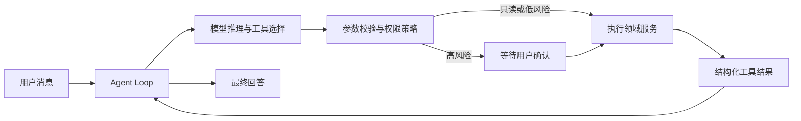

# ApplyPilot

ApplyPilot 是一个面向中文用户的留学申请 AI Agent，也是我的全栈开发项目。

用户可以通过对话查询院校项目、比较申请要求、分析个人背景，并把选校结果转化为申请计划和材料任务。项目重点不只是接入大模型，而是实现一套可执行、可确认、可追踪的 Agent 工作流。

## 主要功能

- AI 对话查询院校项目和申请要求
- 个人档案管理，包括 GPA、语言成绩、经历和申请方向
- 项目搜索、筛选及最多三个项目的对比
- 根据档案生成冲刺、匹配和稳妥分类
- 查看申请要求对应的官网来源和验证状态
- 使用看板管理申请进度、材料任务和截止日期
- 修改关键数据或高风险申请状态前要求用户确认
- 保存对话与运行记录，刷新后可以继续查看

目前项目库包含新加坡、中国香港和英国的 7 所学校、11 个授课型硕士项目。

## Agent 设计

Agent 使用兼容 Anthropic Messages 协议的模型接口。模型负责理解用户目标和选择工具，实际的数据读取与写入由后端工具层完成。



### 工具调用闭环

Agent 可以调用档案、项目、申请和官网研究等工具。一轮回复可以包含多个工具调用，执行结果会以结构化数据返回模型，模型再决定继续调用工具还是生成最终回答。

API 和 Agent 工具共用同一套领域服务，因此网页操作与 Agent 操作遵守相同的参数校验、权限和事务规则，模型不能直接修改数据库。

### Human-in-the-loop

工具会根据当前用户、操作类型和参数判断风险。读取档案或搜索项目可以直接执行；修改 GPA、IELTS，以及提交、撤回、录取或拒绝申请等操作需要用户确认。

如果一批工具调用中存在需要确认的操作，整批调用会暂停。用户确认后继续原来的运行，而不是重新让模型生成工具参数，避免重复执行或只完成一部分操作。

### 安全边界

- 用户身份来自后端登录上下文，不接受模型传入的用户 ID 或管理员权限
- 工具名称和参数在执行前进行校验
- Agent 设置步骤数和工具调用次数上限，防止无限循环
- 前端只渲染白名单中的结构化工具结果，不展示原始工具参数
- 工作区在每轮对话后重新读取业务 API，以数据库结果为准
- 运行记录不保存思维链、系统提示词和原始工具输出

### 证据与事实约束

院校要求会保存官网 URL、采集时间、原文片段和验证状态。模型从官网提取字段时，需要同时返回对应原文；程序会检查原文是否真实存在于抓取页面中，无法匹配的数据不会进入可信结果。

如果两个官方页面给出不同要求，系统会保留冲突证据并标记为待核实，而不是自动选择其中一个值。查不到可靠信息时，Agent 会明确说明信息缺失。

### 会话与可观测性

每次提问都会生成独立的 Agent 运行记录，同一会话可以包含多次运行。数据库保存用户可见的问题、回答、运行状态、工具调用次数和安全的执行事件，用于恢复对话及排查失败原因。

## 技术栈

| 模块 | 技术 |
| --- | --- |
| 前端 | React、TypeScript、Vite、Tailwind CSS、TanStack Router/Query |
| 后端 | FastAPI、SQLModel、Alembic |
| 数据库 | PostgreSQL |
| Agent | Anthropic Python SDK、Tool Calling、Human-in-the-loop |
| 部署 | Docker Compose |
| 测试 | pytest、Playwright |

## 本地运行

需要提前安装 Docker Desktop、Node.js 和 npm。

### 1. 配置环境变量

```powershell
Copy-Item .env.example .env
```

修改 `.env` 中的必要配置：

```dotenv
SECRET_KEY=<随机字符串>
POSTGRES_PASSWORD=<数据库密码>
FIRST_SUPERUSER_PASSWORD=<管理员密码>
```

使用 AI 对话还需要配置兼容 Anthropic Messages 协议的服务：

```dotenv
AGENT_BASE_URL=https://api.deepseek.com/anthropic
AGENT_API_KEY=<API Key>
AGENT_MODEL=deepseek-v4-flash
```

### 2. 启动数据库与后端

```powershell
docker compose up -d db mailcatcher backend
```

### 3. 导入项目数据

```powershell
docker compose exec backend python -m app.seed_gold_requirements
```

### 4. 启动前端

```powershell
npm install
npm run dev
```

启动后可以访问：

- 前端：<http://localhost:5173>
- API 文档：<http://localhost:8000/docs>
- 测试邮件：<http://localhost:1080>

## 测试与评测

后端测试：

```powershell
cd backend
uv run pytest tests -q
```

前端构建检查：

```powershell
npm run build --workspace frontend
```

Agent 评测分为两类：

- 确定性评测：使用预设工具调用验证参数校验、权限、人工确认、状态流转和错误恢复
- 真实模型评测：让模型自行选择工具，观察工具选择、参数错误和冗余调用

真实模型运行记录保存在 `backend/real_eval_repeat3.json`。

> 后端测试可能会清理所连接数据库中的数据，请使用单独的测试数据库。

## 当前限制

- 暂停等待确认的 Agent 状态保存在进程内存中，暂不支持多实例恢复
- 院校官网数据尚未通过后台任务定时更新
- 部分学校官网限制自动访问，因此项目数量仍然有限
- 匹配结果只用于辅助选校，不代表实际录取概率
- 真实模型效果会受到模型服务、网络和提示词的影响

## 项目来源

本项目基于 MIT 许可的 [Full Stack FastAPI Template](https://github.com/fastapi/full-stack-fastapi-template) 搭建基础结构。留学申请领域模型、证据系统、Agent 执行循环、工具权限、人工确认、项目检索和申请看板等功能在此基础上完成。
