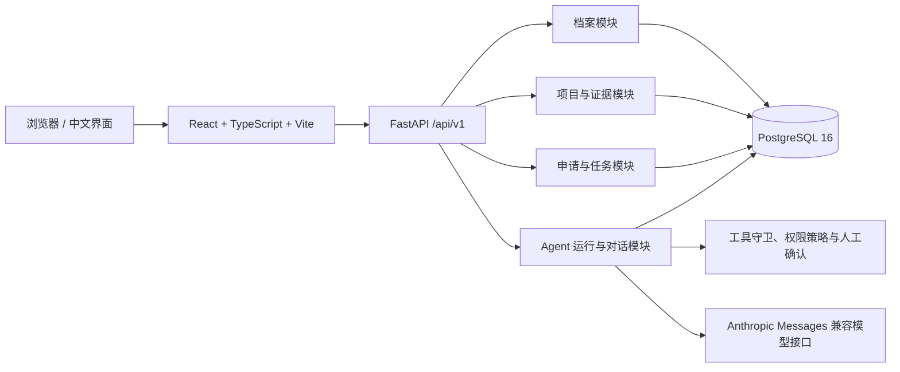

# ApplyPilot

ApplyPilot 是一个全中文、证据驱动的留学申请规划与执行平台。用户可以建立个人档案，用自然语言描述申请目标，由 Agent 调研和比较项目、识别条件差距，并把选校结论转化为可持续跟进的申请与材料任务。

本项目采用模块化单体架构：React 负责用户界面，FastAPI 负责 API、Agent 编排和业务事务，PostgreSQL 保存用户档案、院校证据、申请计划及对话记录。

## 当前功能

### 中文 Agent 工作台

- 使用中文自然语言提出目标或追问，回答、提示、状态和错误信息均使用中文展示。
- 在同一工作台中展示对话区、当前执行状态、工具调用结果和“最近活动”。
- 对话内容写入数据库；刷新页面后可恢复，最近活动可点击进入对应对话。
- 对话区独立滚动，长回答不会再遮住历史消息、输入框或左侧活动列表。
- 支持读取档案、搜索项目、比较项目、查看要求、建立申请和更新任务。
- 修改 GPA、IELTS 等关键数据，或提交、撤回、录取、拒绝等高风险操作时，必须由用户确认后才能执行。

### 个人档案

- 维护本科院校、专业、GPA 与满分、IELTS、工作年限和经历摘要。
- 维护申请预算、目标地区、目标方向和职业目标。
- 新用户可直接创建档案；后续修改保留字段级来源与验证状态。
- 首页显示档案完整度，并将档案作为项目匹配和差距分析的依据。

### 项目库与对比

- 按地区、申请季和专业方向检索授课型硕士项目。
- 最多同时比较 3 个项目。
- 根据用户档案给出“冲刺 / 匹配 / 稳妥”分组、匹配理由和条件差距。
- 展示截止日期、学术背景、语言成绩、学费等已发布要求。
- 学费筛选只比较相同币种，不使用无来源的汇率换算。

### 申请看板

- 将项目加入申请计划，并以看板和时间线查看进度。
- 管理申请状态、截止日期、材料完整度和下一步事项。
- 新建、编辑、完成或删除用户自建任务。
- 系统生成的必要材料任务不可删除；准备度由必要任务是否全部完成确定。
- 对提交、撤回及结果类状态使用中文二次确认，避免误操作。

### 证据库

- 每条项目要求可追溯至官网 URL、抓取时间和验证状态。
- 可按项目、来源和状态筛选证据。
- 新证据与已发布值冲突时，不会静默覆盖，而是进入待复核状态。
- 管理员复核后才会发布新值，并保留完整审计记录。

### 账户与管理

- 注册、登录、密码找回、个人设置和删除账户。
- 管理员用户管理。
- 仪表盘集中展示申请数量、待办材料、近期截止日期和快捷入口。

## 典型用户旅程

1. **建档**：用户一次或多次输入教育、语言、经历、预算和目标信息，确认后保存到个人档案。
2. **提目标**：用户用中文描述地区、方向和预算；Agent 只追问会影响决策的缺失条件。
3. **调研**：Agent 读取档案，检索项目与官网证据，并识别信息冲突或过期风险。
4. **决策**：系统输出冲刺、匹配、稳妥分组，说明匹配理由与差距；用户可比较和调整目标。
5. **执行**：用户确认学校列表后建立申请和材料任务，形成申请时间线。
6. **持续推进**：后续对话继续读取申请状态；用户更新 IELTS、GPA 等信息后可重新评估受影响项目。

## 页面入口

| 地址 | 页面 | 用途 |
| --- | --- | --- |
| `/` | 仪表盘 | 查看档案完整度、申请概况、待办和截止日期 |
| `/agent` | Agent 工作台 | 中文对话、调研、决策与执行 |
| `/profile` | 个人档案 | 维护背景、成绩、经历、预算和申请目标 |
| `/programs` | 项目库 | 搜索、筛选、比较和加入申请计划 |
| `/applications` | 申请看板 | 管理申请状态、材料任务和时间线 |
| `/evidence` | 证据库 | 查看项目要求的来源、时间和验证状态 |
| `/settings` | 账户设置 | 修改个人信息、密码或删除账户 |
| `/admin` | 用户管理 | 管理员维护平台用户 |

## 技术架构



主要技术：

- 前端：React 19、TypeScript、Vite 8、Tailwind CSS 4、shadcn/ui、TanStack Router、TanStack Query。
- 后端：Python 3.12、FastAPI、SQLModel、Pydantic、Alembic。
- Agent：Anthropic Python SDK、显式工具注册、参数校验、权限策略、人工确认和运行追踪。
- 数据库：PostgreSQL 16。
- 测试：pytest、Playwright、Biome、TypeScript 编译检查。
- 部署：Docker Compose、Traefik、单一后端镜像内置前端静态文件。

## 快速启动（Docker，推荐）

### 1. 准备环境文件

Windows PowerShell：

```powershell
Copy-Item .env.example .env
```

macOS / Linux：

```bash
cp .env.example .env
```

至少修改 `.env` 中以下占位值：

```dotenv
SECRET_KEY=请替换为随机长字符串
POSTGRES_PASSWORD=请替换为数据库密码
FIRST_SUPERUSER_PASSWORD=请替换为管理员密码
```

非本地环境禁止继续使用 `changethis`，后端会直接拒绝启动。

### 2. 启动完整开发环境

```bash
docker compose up --build
```

本地 `compose.override.yml` 会自动生效：

- 应用：<http://localhost:8000>
- API 文档：<http://localhost:8000/docs>
- Adminer：<http://localhost:8080>
- MailCatcher：<http://localhost:1080>
- Traefik 面板：<http://localhost:8090>

启动过程会等待数据库、执行全部 Alembic 迁移，并创建初始管理员。

`.env.example` 默认使用 `applypilot` 作为 Compose 项目名、PostgreSQL 数据库名和数据库用户，容器会显示为 `applypilot-db-1`、`applypilot-backend-1` 等。若本机曾使用旧模板名称启动过数据库，请先通过 `pg_dump` 和 `pg_restore` 迁移数据；改名不会删除旧数据卷，但新配置不会自动读取旧数据卷。

需要监听代码变化时使用：

```bash
docker compose watch
```

### 3. 初始化项目目录与官方证据样例

基础目录包含 12 所大学、24 个授课型硕士项目。命令可重复执行，不会覆盖人工核实后的项目 URL 或学制：

```bash
docker compose exec backend python -m app.seed_programs
```

如需加载用于演示和评测的官方要求样例：

```bash
docker compose exec backend python -m app.seed_gold_requirements
```

## 本机开发

前置条件：Python 3.12、[uv](https://docs.astral.sh/uv/)、Node.js、npm 和 PostgreSQL 16。先创建 `.env`，并确保 `POSTGRES_SERVER=localhost`。

安装依赖：

```bash
uv sync
npm install
```

初始化后端：

```bash
cd backend
uv run alembic upgrade head
uv run python -m app.initial_data
uv run python -m app.seed_programs
uv run fastapi dev app/main.py
```

另开终端启动前端：

```bash
npm run dev
```

开发前端默认地址为 <http://localhost:5173>，后端为 <http://localhost:8000>。API 统一位于 `/api/v1`，OpenAPI 文件位于 `/api/v1/openapi.json`。

## Agent 模型配置

Agent 使用 Anthropic Messages 协议适配器，服务地址和模型均通过环境变量指定，不会自动切换到其他供应商：

```dotenv
AGENT_BASE_URL=https://api.deepseek.com/anthropic
AGENT_API_KEY=你的密钥
AGENT_MODEL=deepseek-v4-flash
```

三个变量必须同时有效。`AGENT_API_KEY` 留空时，普通业务功能和确定性测试仍可运行，但真实 Agent 对话、真实模型冒烟测试和真实模型评测不可用。

## 数据库迁移

当前迁移头为：

```text
g7d3a1c85f20
```

升级现有数据库：

```bash
cd backend
uv run alembic upgrade head
```

Docker 启动时会通过 `backend/scripts/prestart.sh` 自动执行同一迁移。迁移包含个人档案、项目与证据、申请任务、Agent 运行记录、持久化对话及可展示问答字段。

## 测试与检查

启动 PostgreSQL 后运行后端测试：

```bash
cd backend
uv run pytest tests -q
```

真实模型测试需要可访问的模型端点和有效密钥。只运行不依赖外网的完整确定性套件：

```bash
uv run pytest tests -q --ignore=tests/agent/test_anthropic_smoke.py --ignore=tests/evaluation/test_real_anthropic_smoke.py --ignore=tests/evaluation/test_real_mode.py
```

前端构建检查：

```bash
npm run build --workspace frontend
```

运行 Playwright 端到端测试前，应保证后端和测试数据库可用：

```bash
npm test
```

项目保留三类验证材料：

- 后端确定性测试覆盖权限判断、人工确认、状态流转、异常恢复和主要业务接口。
- Playwright 测试覆盖 Agent 对话、会话恢复、产品页面和中文界面。
- `backend/real_eval_repeat3.json` 保存了 13 个场景各重复 3 次的真实模型运行记录，共 39 次；该文件用于分析工具选择和失败原因，不代表线上效果承诺。
- 前端可通过 TypeScript 检查和 Vite 生产构建验证；真实模型测试仍依赖有效密钥和可访问的模型服务。

注意：`npm run lint` 当前会调用 Biome 的写入模式，可能自动修改文件；只想查看问题时请先检查脚本参数或在独立分支运行。

## 数据可信度与安全边界

- 项目要求必须带来源 URL 和抓取时间；没有证据的数值不会作为官方要求发布。
- 冲突证据保留旧发布值并进入人工复核，不执行最后写入者覆盖。
- 用户只能读取自己的档案、申请、任务和 Agent 运行记录，管理员也不能借由运行记录接口查看其他用户对话。
- Agent 工具不接受客户端传入的用户身份或管理员权限，身份只来自已认证请求上下文。
- 高风险写入必须确认；确认只授权本次调用，不会绕过业务状态机或数据校验。
- 运行追踪不保存思维链、隐藏推理、工具参数或工具输出，只保存执行元数据和用户可见结果。
- 部署前必须更换全部默认密码，配置正确的 CORS、域名、HTTPS、数据库备份和密钥管理。

## 已知限制

- 对话持久化迁移部署后产生的新对话可以刷新恢复；迁移前未保存正文的旧运行记录无法反向重建完整对话。
- 项目匹配为基于已验证档案和现有证据的确定性辅助判断，不等同于院校录取承诺。
- 系统不会自行推断汇率；跨币种预算比较需要先引入带日期和来源的汇率数据。
- 实时院校网页抓取、定时更新和通知队列尚未作为后台服务接入；当前证据由受控导入流程写入。
- SMTP 未配置时，密码找回邮件无法真实发送；本地 Docker 环境可通过 MailCatcher 检查邮件。

## 目录结构

```text
.
├── backend/
│   ├── app/agent/              # Agent 循环、模型适配与会话状态
│   ├── app/harness/            # 工具校验、权限策略与执行器
│   ├── app/modules/            # 档案、项目、申请、运行记录领域模块
│   ├── app/tools/              # Agent 到领域服务的工具适配
│   ├── app/alembic/versions/   # 数据库迁移
│   └── tests/                  # 后端与 Agent 测试
├── frontend/
│   ├── src/features/           # Agent、档案、项目、证据与申请页面
│   ├── src/routes/             # TanStack Router 页面路由
│   └── tests/                  # Playwright 端到端测试
├── docs/architecture/          # 分阶段架构与业务边界说明
├── compose.yml                 # 通用容器配置
├── compose.override.yml        # 本地开发覆盖配置
└── .env.example                # 环境变量模板（不得写入真实密钥）
```

更深入的事务、证据冲突、Agent 安全和评测设计见 [`docs/architecture/README.md`](docs/architecture/README.md)。

## 项目来源

ApplyPilot 基于 MIT 许可的 [FastAPI Full Stack Template](https://github.com/fastapi/full-stack-fastapi-template) 演进开发。
