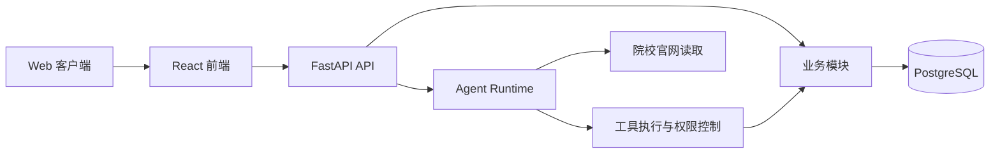

# ApplyPilot

ApplyPilot 是一个面向中文用户的留学申请决策与流程管理平台。系统结合可追溯的院校项目数据、结构化个人档案和工具型 AI Agent，支持项目检索、申请要求核验、选校对比、匹配度评估及申请进度管理。

项目的核心原则是：**涉及院校要求的结论必须具备可核验的官方来源；无法验证的信息不得作为确定事实输出。**

## 核心能力

- **AI 申请助手**：通过自然语言查询院校项目、申请要求和个人申请状态。
- **官方来源追溯**：申请要求关联来源页面、采集时间、原文证据及复核状态。
- **项目检索与对比**：按地区和关键词筛选项目，并对最多三个项目进行结构化比较。
- **匹配度评估**：根据个人档案与已验证要求生成冲刺、匹配或稳妥分组，同时展示判断依据与信息缺口。
- **个人档案管理**：维护教育背景、GPA、语言成绩、经历、预算和申请偏好。
- **申请流程管理**：使用看板和时间线管理申请状态、材料任务与截止日期。
- **高风险操作确认**：修改关键档案字段或执行提交、撤回等状态变更前，要求用户明确确认。
- **官网读取兜底**：项目库缺少信息时，Agent 可读取预先登记的官方页面；新提取数据会标记验证状态，不直接视为已人工复核数据。

## 数据范围

当前内置数据覆盖 7 所院校的 11 个授课型硕士项目，共包含 49 条来源于院校官方网站的申请要求。

| 地区 | 院校 | 项目数量 |
| --- | --- | ---: |
| 新加坡 | NUS、NTU | 4 |
| 中国香港 | HKUST、CUHK、HKU | 5 |
| 英国 | Imperial、Edinburgh | 2 |

部分院校官网会限制自动访问，或仅通过客户端 JavaScript 渲染正文。对于无法稳定获取和验证的页面，系统不会生成缺少证据的项目数据。

## 快速开始

### 前置条件

- Docker Desktop
- Node.js 与 npm
- Git

### 1. 创建环境配置

macOS 或 Linux：

```bash
cp .env.example .env
```

Windows PowerShell：

```powershell
Copy-Item .env.example .env
```

至少需要设置以下变量：

```dotenv
SECRET_KEY=<高强度随机字符串>
POSTGRES_PASSWORD=<数据库密码>
FIRST_SUPERUSER_PASSWORD=<初始管理员密码>
```

如需启用 AI Agent，还需配置兼容 Anthropic Messages 协议的模型服务：

```dotenv
AGENT_BASE_URL=https://api.deepseek.com/anthropic
AGENT_API_KEY=<API 密钥>
AGENT_MODEL=deepseek-v4-flash
```

未配置模型服务时，项目检索、个人档案、项目对比和申请管理仍可正常使用，仅 AI 对话功能不可用。

### 2. 启动数据库与后端

```bash
docker compose up -d db mailcatcher backend
```

启动过程会等待数据库健康检查通过，执行数据库迁移，并按环境变量创建初始管理员账户。

### 3. 导入项目数据

```bash
docker compose exec backend python -m app.seed_gold_requirements
```

### 4. 启动前端

在另一个终端中执行：

```bash
npm install
npm run dev
```

服务地址：

| 服务 | 地址 |
| --- | --- |
| 前端开发服务器 | <http://localhost:5173> |
| 后端 OpenAPI 文档 | <http://localhost:8000/docs> |
| MailCatcher | <http://localhost:1080> |

使用 `.env` 中配置的初始管理员邮箱和密码登录。

## 技术架构



| 层级 | 技术 |
| --- | --- |
| 前端 | React 19、TypeScript、Vite、Tailwind CSS、shadcn/ui |
| 路由与数据状态 | TanStack Router、TanStack Query |
| 后端 | FastAPI、SQLModel、Alembic |
| 数据库 | PostgreSQL 16 |
| Agent | Anthropic Python SDK、工具调用循环、权限分级与人工确认 |
| 基础设施 | Docker Compose、MailCatcher |

## 关键设计

### 可追溯的申请要求

要求数据不仅保存结构化数值，还记录来源 URL、采集时间、原文证据和验证状态。用户可以从前端查看关键字段的证据来源，Agent 在回答时也能区分已验证信息、待核实信息和缺失信息。

### 官方来源冲突保留

当同一院校的不同官方页面提供不一致的要求时，系统保留各条证据并将相关字段标记为待核实，而不是在缺少依据的情况下选择其中一个值。Agent 的回答会明确呈现冲突及其来源。

### 提取结果原文校验

官网读取流程要求模型为每个提取字段提供对应的原文片段。系统对文本进行必要的引号和空白归一化后，将证据片段与获取到的页面正文进行匹配；无法匹配的提取结果不会写入可信数据集。

### 不进行无依据的指标换算

系统不会将英国学位等级等要求自动换算为 GPA，也不会在缺少带日期、来源和币种信息的汇率数据时进行跨币种学费比较。结构化字段为空可能表示当前不存在可靠的官方换算依据，而非数据处理失败。

### 分级权限与人工确认

Agent 工具根据操作风险划分权限。只读查询可以直接执行；修改个人关键数据、改变高风险申请状态等写操作需要用户确认。所有 Agent 运行均保留工具调用和执行结果记录，便于审计与问题定位。

## 测试与质量检查

后端测试：

```bash
cd backend
uv run pytest tests -q \
  --ignore=tests/agent/test_anthropic_smoke.py \
  --ignore=tests/evaluation/test_real_mode.py
```

> [!CAUTION]
> 后端测试会清理测试所连接数据库中的表。执行前必须确认 `.env` 指向专用测试数据库，不得对包含有效数据的开发或生产数据库运行。

前端类型检查与生产构建：

```bash
npm run build --workspace frontend
```

端到端测试需要后端服务处于运行状态：

```bash
npm test
```

真实模型评估记录保存在 `backend/real_eval_repeat3.json`，覆盖档案查询、项目搜索、匹配分析、申请操作、人工确认、错误恢复和官网读取等场景。

## 已知限制

- 当前项目数据主要覆盖新加坡、中国香港和英国，院校及项目数量有限。
- 院校官网内容不会自动定时同步，需要重新执行采集和验证流程。
- 官网读取仅访问代码中登记的官方 URL，不执行不受约束的开放式网络搜索。
- 部分院校网站存在访问限制或动态渲染，无法保证自动采集成功。
- 匹配度评估基于用户档案和现有公开要求，不代表院校实际录取概率。
- 系统不进行缺少可靠来源的 GPA、学位等级或汇率换算。
- 未配置 SMTP 时无法向真实邮箱发送密码重置邮件；本地开发可通过 MailCatcher 查看邮件。

## 项目结构

```text
backend/
  app/agent/          Agent 循环与模型适配
  app/harness/        工具校验、权限控制与执行器
  app/modules/        档案、项目、申请及运行记录模块
  app/research/       官网读取、字段提取与证据校验
  app/tools/          Agent 工具定义
  tests/              后端测试
frontend/
  src/features/       业务功能与页面
  src/routes/         前端路由
  tests/              Playwright 端到端测试
docs/architecture/    架构设计文档
```